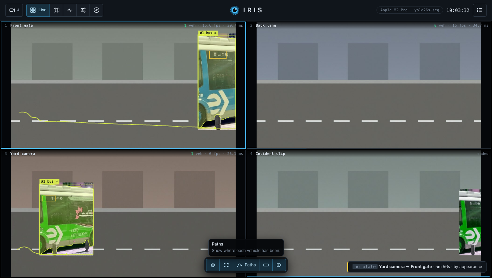
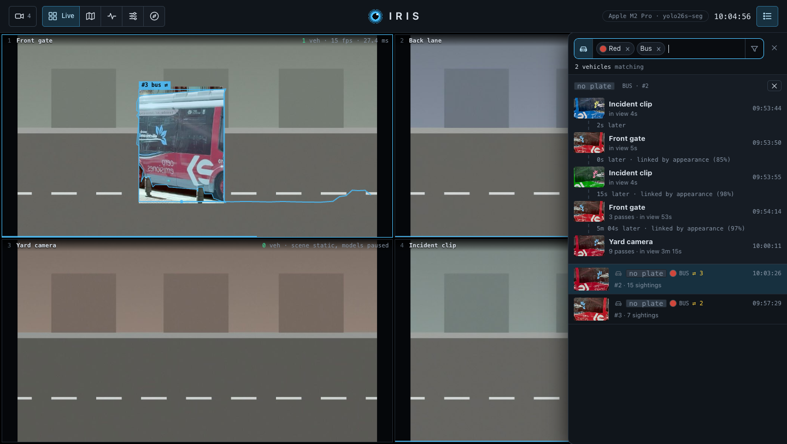
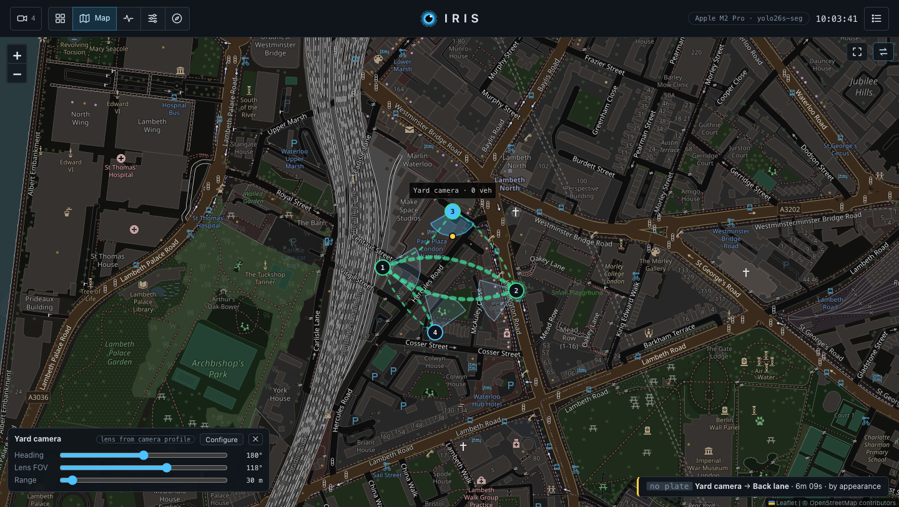
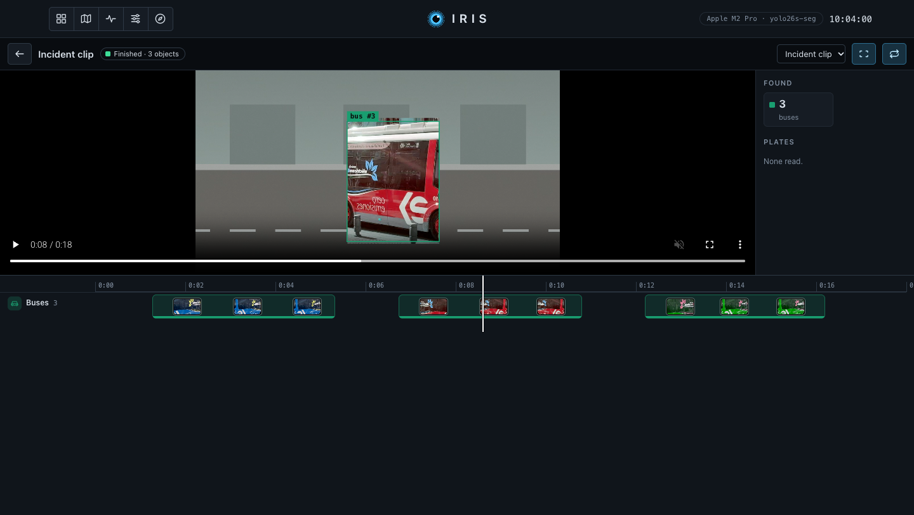
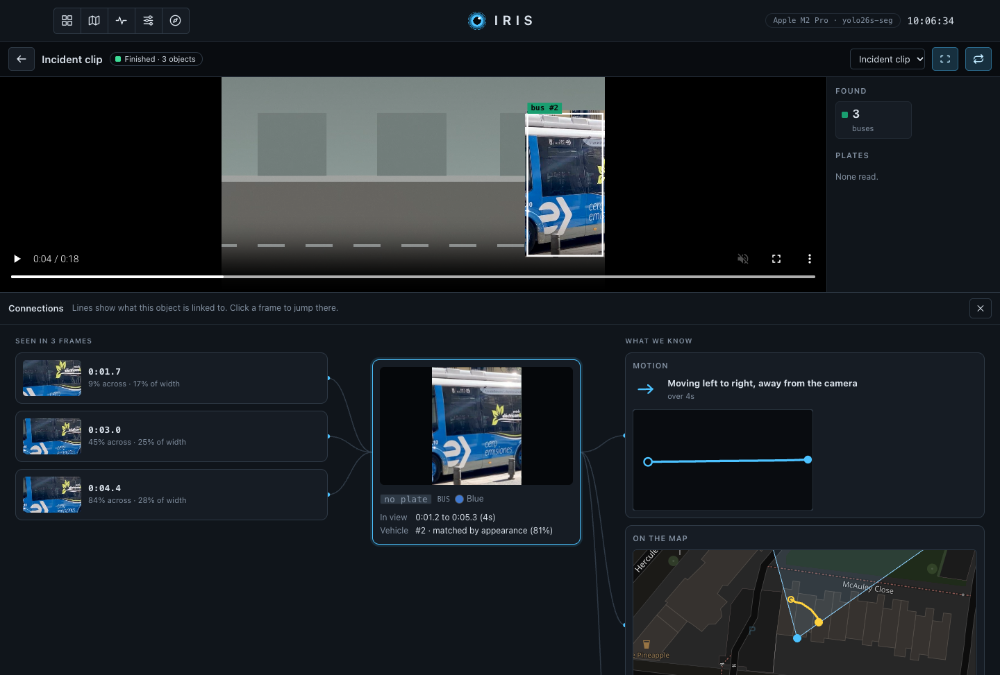
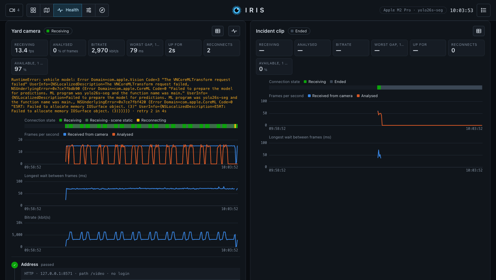
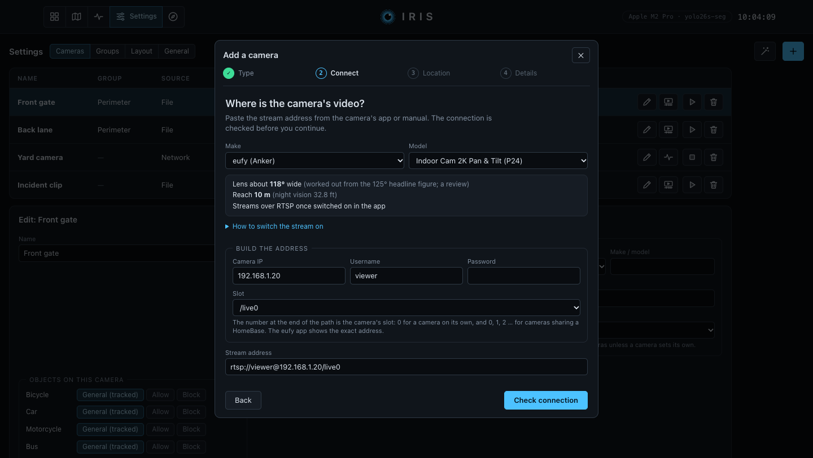
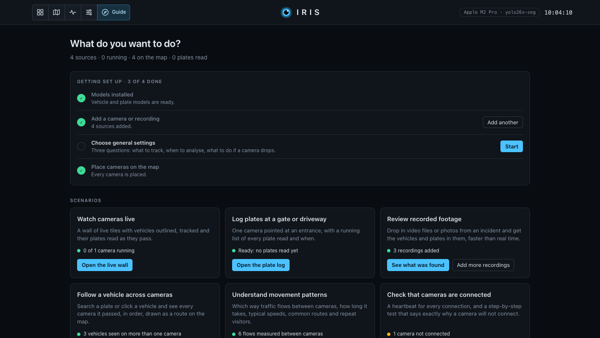

# Iris

Number plate recognition, vehicle tracking and cross-camera analysis for Apple-silicon Macs, with a
control-room dashboard that runs in the browser.



## Where this came from

This repo started in December 2022 as "Number Plate Recognizer": a demo I put together for my UTT
Mechatronics students to use with their robot. It was about a hundred lines. You posted a picture to
a small FastAPI server, EasyOCR read whatever text was in it, and you got the text back. That was
version 0.1, and it did its job.

Then I moved from Windows to macOS. The old stack assumed a CUDA box and none of that came with me,
so I used the move as an excuse to learn how machine learning is done on a Mac. I was working
through MLX at the time and wanted a real project to try Apple's own stack on (Core ML, Vision,
VideoToolbox, Metal, the Neural Engine). I picked this one back up.

About eight months later it is a different application, so it has a different name. **Iris 1.0** is
a from-scratch rebuild: nothing from 0.1 survives except the idea. It runs on the frameworks macOS
ships with instead of a generic CPU/CUDA stack, and it grew from "read one plate from one picture"
into something you could actually leave running on a wall.

The full list of what changed is in [CHANGELOG.md](CHANGELOG.md).

## What it does

- Takes video from network cameras (RTSP/HTTP), recorded files and photos, this Mac's cameras, or a
  screen or window.
- Finds vehicles, outlines them, follows each one through the picture, and reads its plate.
- Recognises the same vehicle again on another camera or in another recording, by plate or by
  appearance, and works out routes, travel times and repeat visitors.
- Shows all of it on a live wall, a map, and a searchable activity feed.
- Reviews a recording frame by frame and lays out everything in it on a timeline.

## A tour, and why each part exists

The screenshots below use synthetic demo footage (one sample bus image, recoloured and driven through
a drawn street), not real cameras or real plates.

### The live wall

The picture at the top. The wall arranges itself: one camera fills the screen, two sit side by side,
three and four get their own grids, and past that it turns into pages (or one page per camera group,
or pages you lay out yourself in Settings). There are no layout buttons, because the app can work
the layout out on its own.

The model returns a mask for each vehicle, not just a box, and drawing the real shape with its path
behind it makes the tracking much easier to follow. The overlay
toggles live in a small toolbar that hides itself until the pointer goes near the bottom edge.

### Searching by what you remember



Nobody remembers a plate. People remember "a red bus, sometime this morning". So the search bar
turns words it understands into chips: type `red` or `maroon` and you get a Red chip, type `truck`
and you get a type chip, and anything left over is matched against the plate. Click a chip to swap
it for another colour.

Colours are deliberately coarse families. These are uncalibrated cameras in changing light, so "red"
has to mean everything that looks red-ish. I would rather it be honest about that than pretend to
tell crimson from maroon.

### The map



Every camera gets a marker and a cone showing where it looks. Once cameras are placed, Iris can tell
that a vehicle went from one to another, how long it took, and roughly how fast. The green arcs are
those measured flows.

Placing cameras also makes the matching stricter, which I like: a vehicle cannot be at two cameras
at once, or cover the distance between them faster than a car can drive, so impossible matches are
thrown out by physics rather than by tuning a threshold.

### Reviewing a recording



When you add a recording you choose between playing it back in real time on the wall, or processing
it immediately. Immediate analyses every frame as fast as the Mac allows and opens this view: the
video on top, and underneath a timeline that fills in while you watch, then settles into one lane
per type of object with preview pictures at the moments they were taken.

This is for the "something happened around three o'clock, here is the file" situation. I wanted to be
able to see the whole clip at a glance instead of scrubbing through it.

### Connections



Click any preview and you get that one vehicle as linked cards: the frames it appeared in, which way
it was moving, where that puts it on the map, and anywhere else it was seen. Honestly, this one
exists because I thought it would be pretty cool to do, and it turned out to be the fastest way to
answer "what do we actually know about this car?".

The map position here is a rough guess (direction from where the vehicle sits in the picture,
distance from how low it sits in the frame). It shows direction of travel, not a survey.

### Connection health



Cameras drop off networks constantly, and "it just says error" is useless. Each connection gets a
heartbeat (frames received against frames analysed, the longest wait between frames, bitrate) and a
step-by-step test that says where it failed and why: wrong address, rejected login, wrong stream
path, or a camera that only streams while it is recording an event.

The second line on the frame-rate chart is there on purpose. Iris skips frames where nothing has
changed, so a quiet driveway costs almost nothing, and the chart shows that happening.

### Adding a camera



Adding a camera is a few questions, one at a time: what it is, how to reach it, where it is and which
way it faces, and what it should watch for. Network addresses are tested before you continue.

Pick a make and model and Iris fills in what it knows from a small local database: how to switch the
stream on, how the address is built, which stream slots to try, and the lens angle for the map cone.
eufy is the only brand in there so far; that is where I started. The database is one JSON file and
is meant to grow.

### The guide



A page that lists the jobs Iris can do, says whether each one is ready or what it still needs, and
gives you one button for the next step. The app does a lot by now, and a list of what it can do is
easier than hunting for it.

## Getting started

You need an Apple-silicon Mac, Python 3.14 and [uv](https://docs.astral.sh/uv/).

```sh
uv sync
uv run python -m npr setup   # one-off: converts the vehicle model to Core ML, fetches the plate model
uv run python -m npr serve   # then open http://127.0.0.1:8314
```

The Python package and the command are still called `npr`, a leftover from the old name.

macOS asks for Screen Recording and Camera permission the first time you use those sources. The
permission belongs to whichever app launched Iris (Terminal, VS Code and so on).

Then open **Settings → Add camera**, or the **Guide** tab if you would rather be walked through it.

## Under the hood

Iris leans on what the Mac already has:

| Job | Done by |
|---|---|
| Video decode | AVFoundation and VideoToolbox (hardware) |
| Screen and camera capture | ScreenCaptureKit, AVFoundation |
| Vehicle detection and outlines | YOLO26-seg converted to Core ML, run through Vision |
| Plate detection | An ONNX model on the Core ML execution provider |
| Reading plates | Vision text recognition |
| Recognising a vehicle again | Vision feature-prints plus a colour signature |
| Scaling and encoding tiles | Core Image on Metal |

Python orchestrates; the frames themselves stay in the native formats those frameworks pass between
each other. The details, every setting, and how the matching works are in
[docs/REFERENCE.md](docs/REFERENCE.md).

## What is still rough

I would rather say this up front than have someone find out the hard way.

- **Matching by appearance alone is a best guess.** With a plate, matches are reliable. Without one,
  Iris compares a general-purpose image fingerprint, and it can decide two different vehicles are the
  same one. You can see it in the search screenshot above, where recoloured copies of one bus were
  linked together. Every match shows how it was made and how sure it was.
- **Plates need pixels.** A plate has to be roughly 24 pixels wide before it is even attempted.
- **Colour is a family, not a shade,** and orange and brown fall into their neighbours.
- **Camera profiles are thin.** Only eufy, and much of that comes from community lists rather than
  the manufacturer. Each value records where it came from.
- **Most of my testing so far has been on synthetic and sample footage.** It needs more hours on real
  cameras in real weather.
- **No login.** The server only listens on this Mac. Put it behind your own access control before
  exposing it to a network.
- **Check your local law** before recording or processing number plates.

I think once I've learnt a bit more about these processes, I might experiment with some new features.
